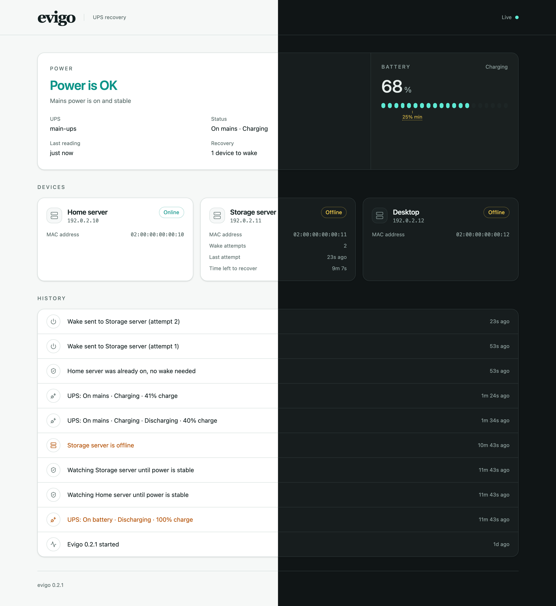

# Evigo

Evigo turns your devices back on after a power cut.

When the power goes out, your UPS keeps things running for a while and then your
existing shutdown setup powers devices off safely. Evigo watches
your UPS, remembers which devices were running before the outage, and wakes
them with Wake-on-LAN once the power is back and safe.

Evigo only ever turns devices **on**. It never shuts anything down and never
sends commands to your UPS, so keep your existing shutdown setup as it is.



## How it works

1. **Before an outage:** Evigo keeps an eye on your UPS and checks which of your
   devices are online.
2. **When the power goes out:** it notes which devices were running just before.
   Devices that were already off are left alone.
3. **When the power comes back:** it waits until power has been steady for a short
   while and the UPS battery has recharged enough to cover another outage.
   Devices that are still on by then never went off, or came back by themselves,
   and are left as they are.
4. **Then it wakes the devices that are off,** retrying every so often until each
   one comes back online, or gives up after a while if one never does.

If Evigo itself restarts in the middle of this, for example because the host
it runs on also lost power, it picks up where it left off.

If Evigo loses contact with the UPS, or there's a long gap between its checks,
it starts the wait for stable power again.

## What you need

- A UPS monitored by [Network UPS Tools (NUT)](https://networkupstools.org/), with
  its server reachable from where Evigo runs.
- Devices with **Wake-on-LAN enabled** in their BIOS/UEFI and network settings.
- An always-on Linux host on the **same network** as the devices you want to
  wake, to run Evigo. Docker or a systemd-based Linux install both work.
- Each device's IP address (or hostname) and MAC address.

## Quick start with Docker

1. Download [`compose.yaml`](compose.yaml) and
   [`config.example.yaml`](config.example.yaml) into a new folder, and rename the
   example to `config.yaml`.
2. Edit `config.yaml` with your UPS and devices (see [Configuration](#configuration)).
3. Check the configuration:

   ```sh
   docker compose run --rm evigo validate --config /etc/evigo/config.yaml
   ```

4. Start Evigo and watch the logs:

   ```sh
   docker compose up -d
   docker compose logs -f evigo
   ```

You should see `Evigo started` followed by your UPS status.

Docker must run on a Linux host.

## Installing on Linux without Docker

```sh
curl -fsSL https://github.com/Jack-Overflow/Evigo/releases/latest/download/install.sh -o install.sh
sudo sh ./install.sh
```

The installer downloads and verifies the latest release, creates an `evigo`
system user, and installs a systemd service. It doesn't start anything. Then:

```sh
sudoedit /etc/evigo/config.yaml
sudo -u evigo evigo validate --config /etc/evigo/config.yaml
sudo systemctl enable --now evigo
journalctl -u evigo -f
```

The installer needs systemd, `curl` or `wget`, `tar`, `awk`, `sha256sum` and the
iputils version of `ping`, which most distributions include. It tells you if
anything is missing.

## Configuration

Everything lives in one YAML file. The [example](config.example.yaml) lists every
setting with its default, so you only need to fill in your own details:

```yaml
nut:
  host: 192.0.2.5 # your NUT server
  ups: myups # the UPS name as NUT knows it
devices:
  - id: nas
    name: NAS
    host: 192.0.2.20
    mac: "02:00:00:00:00:01"
  - id: server
    name: Home server
    host: 192.0.2.21
    mac: "02:00:00:00:00:02"
```

Restart Evigo after changing the file. Run `evigo validate` first: for a mistyped
or invalid setting, it tells you which one and on which line.

### Settings you might want to change

| Setting                        | Default | What it does                                                                                                           |
| ------------------------------ | ------- | ---------------------------------------------------------------------------------------------------------------------- |
| `recovery.min_battery_percent` | `25`    | How charged the UPS battery must be before devices are woken.                                                          |
| `recovery.stable_power_delay`  | `30s`   | How long power must stay on before waking anything. Set it longer than a shutdown takes to finish after mains returns. |
| `recovery.retry_interval`      | `30s`   | How often to resend the wake signal to a device that hasn't come back.                                                 |
| `recovery.device_timeout`      | `10m`   | How long to keep trying before giving up on a device.                                                                  |

### NUT login

If your NUT server needs a login, add a username and password. You can keep them
out of the file by using environment variables (with Docker, put them in a `.env`
file next to `compose.yaml`) or a password file:

```yaml
nut:
  username: monitor
  password: "${NUT_PASSWORD}"
  # or: password_file: /etc/evigo/nut-password
```

NUT sends passwords unencrypted, so only use it on a network you trust.

### Devices on another network

Wake-on-LAN signals don't normally cross between networks or VLANs. Either run
Evigo on the same network as the devices, or set a directed broadcast address
for the device (your router must allow it):

```yaml
devices:
  - id: nas
    name: NAS
    host: 198.51.100.20
    mac: "02:00:00:00:00:01"
    wol:
      broadcast: 198.51.100.255
```

## Dashboard and status API

Evigo can serve a read-only dashboard, and the status API behind it, over HTTP.
It's off until you choose an address for it:

```yaml
web:
  listen: 127.0.0.1:8080
```

Then open `http://127.0.0.1:8080` on the host running Evigo. The dashboard
shows:

- **Power:** whether mains power is safe, why waking is paused if it is, and a
  countdown while power is stabilising.
- **Battery:** the charge against `min_battery_percent`.
- **Devices:** whether each one answers ping and, during recovery, its wake
  attempts and time left.
- **History:** UPS changes, reachability changes, wakes and recoveries, 15 at a
  time.

It refreshes every few seconds. If Evigo stops answering or stops checking, the
page says so and greys out the last known state rather than showing it as
current.

There is **no login**. Anyone who can reach it can see your UPS and devices, so
keep it on `127.0.0.1` or put it behind a reverse proxy that adds a login and
HTTPS. IP addresses and `localhost` always work. If you also reach it by a
hostname, list that name, without a port, so Evigo accepts it:

```yaml
web:
  listen: 127.0.0.1:8080
  allowed_hosts: [evigo.example.lan]
```

| Request                               | Returns                                                                                                   |
| ------------------------------------- | --------------------------------------------------------------------------------------------------------- |
| `GET /api/status`                     | UPS status, each device's reachability, recovery progress, and why waking is blocked right now, if it is. |
| `GET /api/history?limit=50&before=ID` | Recent events, newest first. Pass `next_before` as `before` for older ones.                               |
| `GET /health`                         | `200` while Evigo is checking your UPS and devices normally, `503` otherwise; useful for uptime monitors. |

Evigo keeps the newest 10,000 history events and deletes older ones as new ones
arrive.

## Troubleshooting

**A device wasn't woken.** Check that:

- it was online when the power went out (devices that were already off are left
  off on purpose),
- Wake-on-LAN works for it, for example by testing with another Wake-on-LAN tool,
- it was off once power became stable; a device still answering ping then is
  treated as on and left alone,
- the battery reached `min_battery_percent`; the logs show the UPS status and
  battery level.

**Every device shows as unknown.** Evigo checks devices with `ping`. In Docker,
the host must allow the container's group (`10001`) to ping:

```sh
sysctl net.ipv4.ping_group_range
```

If `10001` isn't inside that range, widen it in `/etc/sysctl.d/`. For a native
install, do the same for the `evigo` group the installer printed. Devices Evigo
can't check are never woken, so this is worth fixing first.

**A slow device was missed.** If it was still shutting down when the power came
back and answered ping until the stability delay ended, increase
`stable_power_delay` so it's longer than the device's shutdown.

**Evigo won't start because the web address is in use.** Pick a different
`web.listen` port, or leave it empty to turn it off.

**Evigo won't start because of its database.** Evigo refuses a database file it
doesn't recognise and leaves the file untouched. Stop it, move the file aside,
and start again.

## Upgrading

- **Docker:** `docker compose pull && docker compose up -d`
- **Linux:** stop the service, run the installer again, then start the service.
  Your configuration is kept.

## Contributing

See [CONTRIBUTING.md](CONTRIBUTING.md) to get started and [AGENTS.md](AGENTS.md)
for architecture, safety rules and development commands.

## Security

See [SECURITY.md](SECURITY.md) for reporting vulnerabilities privately.

## License

Apache-2.0. See [LICENSE](LICENSE) and [third-party notices](THIRD_PARTY_LICENSES).
